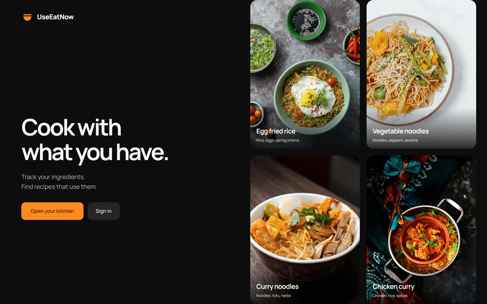
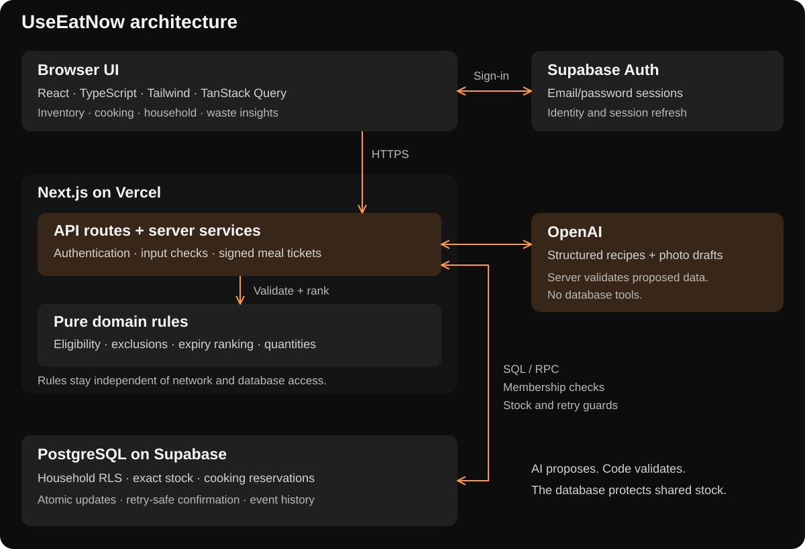

# UseEatNow

A team project for NTU SC3040 Advanced Software Engineering, focused on project management
and software delivery: planning, change control, risk, quality assurance and release coordination.

The product is a shared household pantry that turns available ingredients into meal suggestions.
It tracks exact quantities, reserves cooking portions, and records actual use and waste.

[Live demo](https://useitnow.utf.sh) · [Project board](https://github.com/users/faqihxdev/projects/1) · [User guide](docs/user-guide.md) · [Development](docs/development.md)

## Architecture

React, TypeScript and Tailwind run in the browser. Next.js on Vercel handles authenticated
requests and AI services. Pure domain rules validate recipes; Supabase Auth and PostgreSQL
control identity, household access and stock updates.

## Engineering highlights

| Capability                | Implementation                                                                                                                                                                        |
| ------------------------- | ------------------------------------------------------------------------------------------------------------------------------------------------------------------------------------- |
| Shared stock              | Exact amounts and units, atomic portion reservations, reloadable cooking sessions and retry-safe confirmation. Version checks and undo protect concurrent edits.                      |
| Controlled AI             | Schema-constrained recipes use supplied ingredient IDs. Server rules check amounts, units and exclusions before issuing signed cooking tickets. Models receive no database tools.     |
| Household privacy         | Supabase Auth sessions, PostgreSQL row-level security and server-side membership checks isolate household data and restrict owner actions.                                            |
| Photo review              | Recognition produces editable drafts. Users confirm amounts and expiry dates before a transactional batch import; the batch can be undone.                                            |
| Waste insights            | Meal records retain actual use, discarded amounts, reasons and expiry snapshots for ingredient-level breakdowns.                                                                      |
| Verification and recovery | Domain tests, transactional SQL suites and Chromium/Firefox workflows check shared-stock behavior. Restore drills compare records and access-control settings in a separate database. |

See [change records](https://github.com/faqihxdev/sc3040-adv-swe/issues/63),
[testing and evidence](docs/testing.md), [CI](https://github.com/faqihxdev/sc3040-adv-swe/actions/workflows/app-checks.yml)
and [deployment and recovery](docs/deployment.md) for details.

## Contributing

Use `<name>/<type>-<description>` branches and `<type>: <description>` commits and PR titles.
See the [development workflow](docs/development.md#contributing) for setup, checks and code conventions.

## Team

Muhammad Faqih Akmal · Phang Wei Zhang · See Toh Jin Jie · Gladys Woo Hui Min ·
Chin Shao Yang · Eileen Lim Jing Wen.

## Project records

The project board and issues record delivery work and change decisions. Formal course plans,
meeting minutes and backlogs are maintained in the GitLab submission.
The hosted demo uses team-provided accounts; registration is disabled.
